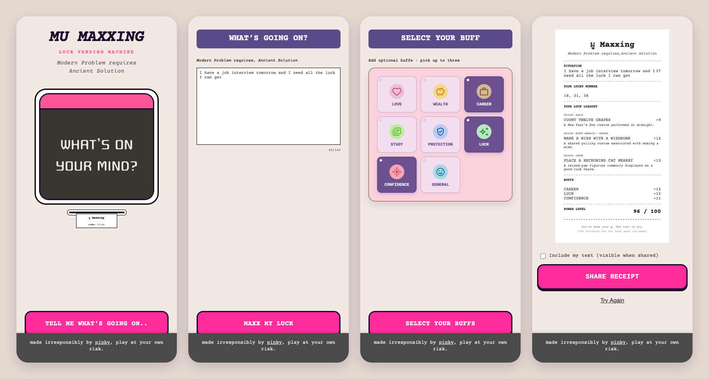

# มู Maxxing — Luck Vending Machine

> Modern problem requires, ancient solution.

มู Maxxing is a small web toy. You tell it what's going on, pick some "buffs", and a vending machine prints you a luck receipt: three lucky numbers, a loadout of real good-luck customs from around the world, and a power level out of 100. Then you share the receipt.

It's made irresponsibly. Play at your own risk.



---

## The idea

**มู** ("mu", short for *mutelu*) is Thai slang for the whole culture of luck-seeking: charms, lucky colours, rituals before an exam or a job interview. *Maxxing* is internet slang for pushing something as far as it can go. Put them together and you get the joke: what if you could min-max your luck the way people min-max a game character?

That framing set most of the design decisions:

- **A vending machine, not a fortune teller.** You put a problem in and a receipt comes out. It's transactional and a little absurd, and it makes no claim to wisdom.
- **Game language.** Buffs, loadouts, points and a power level turn superstition into stats. The stats are made up, which is the point.
- **A receipt as the output.** Receipts are cheap, a little ugly and very shareable. The fine print does the honest work: *"You've done your มู. The rest is you."* and *"\*The universe has not been peer reviewed."*

## The flow

```
Intro ─▶ Input ─▶ Loading ─▶ Buffs ─▶ Printing ─▶ Receipt
            │                                       │
            └─▶ Safety (sensitive topics) ──────────┘
```

1. **Intro**: the machine, a title, and one button: *"Tell me what's going on.."*
2. **Input**: a 140-character box. It's short on purpose: this is a vibe check, not therapy.
3. **Loading**: a progress bar and rotating copy (*"Negotiating with destiny..."*, *"Reading the cosmic fine print..."*). It's theatre: the machine doesn't need the time, but the anticipation is part of the fun.
4. **Buffs**: pick up to three from Love, Wealth, Career, Study, Protection, Luck, Confidence and General. Each one adds points to your power level and steers which rituals you get.
5. **Printing**: the receipt feeds out of the slot.
6. **Receipt**: your situation, lucky numbers, ritual loadout, buffs and power level, plus a share button. Including your own text on the shared image is opt-in.

## Thinking it through

### Keeping the rituals real

A joke app could just invent its rituals, but the joke is better when the rituals are real. Before writing the loadout I did a research pass, [docs/research/luck-protection-fortune-practices.md](docs/research/luck-protection-fortune-practices.md). It lists public, low-risk luck customs, each backed by an authoritative source (Britannica, UNESCO, the Smithsonian, national museums and culture ministries).

The rules for what made it in:

- **Public, everyday practices only.** Nothing initiation-only, restricted or sacred.
- **Small and doable.** Each one is an object you can carry or an action you can do: wear something red, knock on wood, set one eye on a daruma.
- **Credited.** Every item on the receipt shows its origin (*ORIGIN: JAPAN*, *ORIGIN: TURKEY*), so the culture behind it gets the credit.
- **Low-risk alternatives.** Animal-derived charms are noted as history only, and food customs are described as culture, not as dietary advice.

That research became the 20 rituals in [app/src/types.ts](app/src/types.ts). Each one is tagged with the buffs it matches.

### Building in a safety net

People will type real things into a box that asks *"What's going on?"*. A luck machine has no business answering a medical, legal or financial crisis with "wear something red".

So the input is checked against a short list of sensitive terms ([app/src/logic.ts](app/src/logic.ts)) covering self-harm, emergencies, medical, legal and debt or investment topics, in English and Korean. If one matches, you get **A gentle pause** instead of a receipt. That screen says plainly that this is entertainment, not professional advice, and points you to a trusted person or a local service. You can then try a lighter prompt, or continue with a *general* ritual that ignores what you wrote.

A keyword list is a blunt tool and it will miss things. It still beats having no net at all, and it's an obvious place to improve.

### Randomness on purpose

The randomness is deliberate:

- **Rituals**: three are drawn at random from the ones matching your buffs, so the same input gives a new loadout each time.
- **Lucky numbers**: three distinct numbers between 1 and 45.
- **Situation score**: a tiny hash of your text, so the same sentence always gets the same score. It feels oddly personal.
- **Power level**: a base of 58 plus your buff points, capped at 100. You can't max out without trying.

## Building it

### Design first, in Figma

Every screen was designed in Figma at phone size before any code was written, including the motion. Each animated screen runs one 2-second timeline: the header drops in, the machine springs up, the receipt feeds out, the slip card settles.

### Design to code

The build is a near pixel-for-pixel translation of the Figma file:

- **Layout and type** use the Figma values as-is, down to the 5px receipt text and the 2.5px tile borders. The three fonts are Courier Prime (receipt), Cousine (labels) and Cute Font (the machine's screen).
- **Motion** was pulled straight from the Figma file into [app/src/figmaMotion.ts](app/src/figmaMotion.ts). Keyframe timings and Figma's custom spring curves are copied verbatim and run with [Motion](https://motion.dev). The one addition is a clip-path reveal on the printing screen, so the receipt looks like it's coming *out of* the slot instead of fading in.
- **Reduced motion is respected.** With `prefers-reduced-motion` on, the animations are skipped and the screens advance after a short hold.

### Stack

| | |
|---|---|
| Framework | React 19 + TypeScript |
| Build | Vite |
| Styling | Tailwind CSS v4, with design tokens in [app/src/index.css](app/src/index.css) |
| Animation | Motion |
| Lint | Oxlint |
| Hosting | Netlify |

The app has no backend and no router. [app/src/App.tsx](app/src/App.tsx) is a small state machine: the current screen plus the answers so far. `AnimatePresence` slides between screens, forward or back depending on direction.

### Sharing the receipt

The share button turns the on-screen receipt into a PNG without a screenshot library ([app/src/utils/receipt.ts](app/src/utils/receipt.ts)):

1. Clone the receipt node and inline every computed style onto the clone.
2. Inline its images as data URLs, so nothing has to load later.
3. Wrap the clone in an SVG `<foreignObject>`, draw it onto a canvas at 3×, and export a PNG.
4. Share it with the Web Share API, or download it where sharing isn't available.

### Making it responsive

Because the design is pixel-matched to a phone frame, the usual approach of adding breakpoints to every screen would have meant redesigning every screen. Instead:

- **On phones** the app is a full-height column up to 430px wide.
- **On tablets and desktops** the whole column is scaled up with CSS `zoom` to fit the screen, capped at 1.5×. It's never scaled below 1×, so small text never gets smaller. See [app/src/components/PhoneShell.tsx](app/src/components/PhoneShell.tsx).
- **On narrow phones** the one fixed-width element, the loading bar, now shrinks to fit.
- **Receipt export** measures the receipt's unscaled size, so the shared image comes out the same whatever the zoom.

### Timeline

| Date | Milestone |
|---|---|
| Sep 14, 2026 | Project set up. v1 prototype with all six screens and the Figma motion, deployed to GitHub Pages |
| Oct 12, 2026 | Research-backed ritual list, safety screen, rotating loading copy, buff-aware loadouts, receipt sharing |
| Oct 15, 2026 | Moved hosting to Netlify |
| Oct 22, 2026 | Fixed images in shared receipts, made the layout responsive |

## Running it locally

```bash
cd app
npm install
npm run dev      # start the dev server
npm run build    # type-check and build to app/dist
npm run lint     # run oxlint
```

## What's next

- A smarter safety check than a keyword list
- Choosing rituals based on what you wrote, not just the buffs (`selectLoadout` already takes the situation and ignores it for now)
- Thai-language copy, since มู is a Thai idea

---

Made irresponsibly by [pinky](https://builds.pinkyarun.com/).
